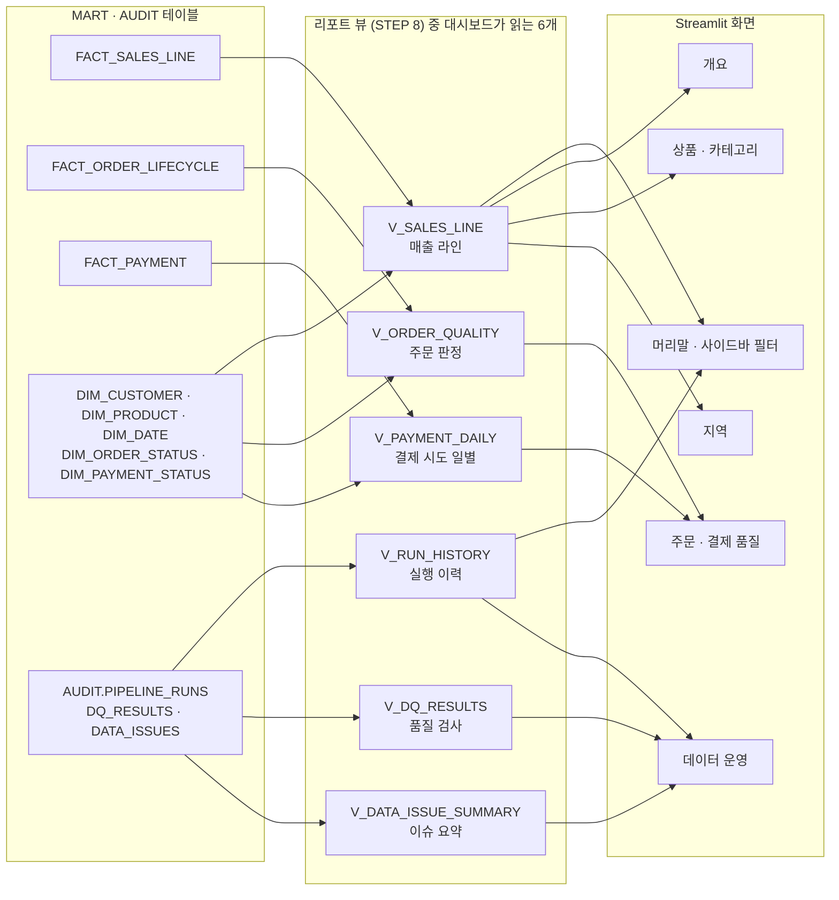

# 대시보드 가이드 : MART 뷰가 Streamlit 화면에서 쓰이는 방식

`streamlit/streamlit_app.py`(Streamlit in Snowflake)가 MART의 어떤 뷰를 읽고, 탭마다 어떤 컬럼·필터·계산으로 숫자를 만드는지 정리한 문서입니다. 화면에 보이는 숫자가 맞는지 워크시트에서 같은 SQL로 확인하는 방법도 담았습니다.
배포 방법과 권한 설정은 [README의 Streamlit 대시보드](../README.md#streamlit-대시보드)를, 뷰의 원천 테이블과 컬럼은 [스키마 안내](schema_guide.md)와 [데이터 사전](data_dictionary.md)을 보세요.

## 1. 한눈에 보기

대시보드는 **MART 뷰 6개만** 읽습니다. Fact·차원 테이블이나 AUDIT 테이블은 직접 읽지 않습니다. 뷰는 노트북 STEP 8(`sql/10_report_views.sql`)이 만듭니다.



| 화면 구간 | 읽는 뷰 | 적용되는 사이드바 필터 | 쿼리 수 (기본 설정) |
|---|---|---|---:|
| 머리말 (데이터 기준 시각·최근 실행·데이터 범위) | `V_RUN_HISTORY`, `V_SALES_LINE` | 없음 | 3 |
| 사이드바 (지역·카테고리 선택지) | `V_SALES_LINE` | 없음 | 2 |
| 공통 KPI (개요 탭의 지표 5개) | `V_SALES_LINE` | 기간·지역·카테고리 | 2 |
| 개요 | `V_SALES_LINE` | 기간·지역·카테고리 | 6 |
| 상품 · 카테고리 | `V_SALES_LINE` | 기간·지역·카테고리 | 5 |
| 지역 | `V_SALES_LINE` | 기간·지역·카테고리 | 3 |
| 주문 · 결제 품질 | `V_ORDER_QUALITY`, `V_PAYMENT_DAILY` | 기간·지역 (카테고리 제외) | 4 |
| 데이터 운영 | `V_RUN_HISTORY`, `V_DQ_RESULTS`, `V_DATA_ISSUE_SUMMARY` | 없음 (실행 선택만) | 3 |

기본 설정(최근 90일, 이전 동일 기간과 비교)에서 화면을 한 번 그리면 쿼리 28개가 실행됩니다. 비교 기준을 "비교 안 함"으로 바꾸면 비교 기간 쿼리 7개가 빠져 21개입니다.
Streamlit의 `st.tabs`는 보이지 않는 탭의 코드도 매번 실행하므로, 어느 탭을 보든 28개가 모두 실행됩니다. 결과는 10분 동안 캐시되므로 같은 필터로 다시 그릴 때는 Snowflake에 쿼리를 다시 보내지 않습니다.

## 2. 리포트 뷰 13개와 대시보드 사용 여부

STEP 8은 뷰 13개를 만듭니다. 대시보드는 그중 6개를 쓰고, 나머지 7개는 노트북의 확인 쿼리와 실습에서 씁니다.

| 뷰 | 한 행 | 매출 인식 주문만 | 소프트 삭제 제외 | DIM_CUSTOMER 조인 (행 접근 정책) | 대시보드 | 그 밖의 사용처 |
|---|---|---|---|---|---|---|
| `V_SALES_LINE` | 주문 상세 1줄 | 예 | 예 | 예 (주문 당시 고객) | 머리말, 사이드바, 개요, 상품, 지역 | |
| `V_ORDER_QUALITY` | 주문 1건 (모든 상태) | 아니오 (판정 결과 포함) | 예 | 예 | 주문 · 결제 품질 | STEP 10 |
| `V_PAYMENT_DAILY` | 결제일 × 지역 × 결제 상태 | 아니오 (모든 결제 시도) | 예 | 예 | 주문 · 결제 품질 | |
| `V_RUN_HISTORY` | 실행 1회 | | | 아니오 | 머리말, 데이터 운영 | 알림 메일 문구 |
| `V_DQ_RESULTS` | 실행 × 품질 검사 | | | 아니오 | 데이터 운영 | [처리 규칙](data_rules.md) 진단 쿼리 |
| `V_DATA_ISSUE_SUMMARY` | 실행 × action × error_code × 파일 | | | 아니오 | 데이터 운영 | |
| `V_REVENUE_DAILY` | 주문일 | 예 | 예 | 예 | 사용 안 함 | STEP 9 보안 체험, STEP 10 |
| `V_REVENUE_CALENDAR` | 달력 날짜 (매출 없는 날 0) | 예 | 예 | 예 | 사용 안 함 | STEP 10 |
| `V_REVENUE_BY_PRODUCT` | 상품 | 예 | 예 | 예 | 사용 안 함 | STEP 10 |
| `V_REVENUE_BY_REGION_ASWAS` | 지역 (주문 당시) | 예 | 예 | 예 | 사용 안 함 | STEP 10, STEP 11 SCD2 체험 |
| `V_REVENUE_BY_REGION_ASIS` | 지역 (현재) | 예 | 예 | 예 | 사용 안 함 | STEP 11 SCD2 체험 |
| `V_PAYMENT_SUMMARY` | 결제 상태 | 아니오 | 예 | 예 | 사용 안 함 | STEP 10 |
| `V_LATEST_RUN` | 가장 최근 실행 1행 | | | 아니오 | 사용 안 함 | STEP 10, [처리 규칙](data_rules.md) 진단 쿼리 |

**대시보드가 미리 집계된 뷰 대신 `V_SALES_LINE`을 쓰는 이유.** 사이드바에서 기간·지역·카테고리를 함께 거르려면 이 세 값이 한 행에 모두 있어야 합니다. `V_REVENUE_DAILY`(날짜만)나 `V_REVENUE_BY_PRODUCT`(상품만)처럼 미리 집계된 뷰는 다른 축으로 다시 거를 수 없습니다. 그래서 매출 화면은 라인 단위 뷰 하나를 읽고, 필요한 집계는 쿼리마다 `GROUP BY`로 만듭니다. 이 방식이면 KPI·추이·카테고리·지역·상품 순위의 합계가 언제나 서로 맞습니다.

**지역은 모두 "주문 당시" 기준입니다.** `V_SALES_LINE`, `V_ORDER_QUALITY`, `V_PAYMENT_DAILY`는 Fact에 저장된 `customer_key`(주문일 기준 SCD2 버전)로 `DIM_CUSTOMER`를 조인합니다. 그래서 고객이 이사해도 과거 매출의 지역은 바뀌지 않습니다. 현재 지역 기준(`V_REVENUE_BY_REGION_ASIS`)은 대시보드에 없습니다.

## 3. 모든 탭에 공통인 동작

### 3-1. 세션과 캐시

| 항목 | 동작 |
|---|---|
| 세션 | 웨어하우스 런타임은 `get_active_session()`, 컨테이너 런타임은 `st.connection("snowflake")`. 시작할 때 `AE101_SALES_ENT` 를 기본 DB로 지정 |
| 캐시 | 같은 SQL과 같은 바인딩 값의 결과를 10분(`CACHE_TTL_SEC = 600`) 동안 재사용 |
| 새로 고침 | 사이드바의 "캐시 비우고 새로 고침" 버튼이 캐시를 지우고 다시 그림. 파이프라인 실행 직후 숫자가 안 바뀌면 이 버튼을 누름 |
| 필수 쿼리 | `V_SALES_LINE`, `V_ORDER_QUALITY`, `V_PAYMENT_DAILY` 쿼리가 실패하면 오류 상세를 보여 주고 화면을 멈춤 |
| 선택 쿼리 | `V_RUN_HISTORY`, `V_DQ_RESULTS`, `V_DATA_ISSUE_SUMMARY` 쿼리는 실패해도 안내 문구만 보이고 나머지 화면은 그대로 동작 |

### 3-2. 사이드바 필터가 SQL로 바뀌는 방식

| 필터 | 선택지가 오는 곳 | SQL 조건 |
|---|---|---|
| 기간 | 프리셋(최근 30일·90일·12개월, 올해 누적, 전체 기간, 직접 선택). 기본은 **최근 90일**. 기준일은 오늘이 아니라 `V_SALES_LINE`의 마지막 주문일 | `order_date BETWEEN TO_DATE(?) AND TO_DATE(?)`. 결제 쿼리는 `paid_date` 를 씀 |
| 비교 기준 | 이전 동일 기간(기본), 전년 동기, 비교 안 함 | 같은 쿼리를 비교 기간 날짜로 한 번 더 실행 |
| 집계 단위 | 일·주·월. 기간이 62일 이하면 일, 370일 이하면 주, 그보다 길면 월이 기본 | `DATE_TRUNC('<단위>', order_date)` |
| 지역 | `SELECT DISTINCT region FROM MART.V_SALES_LINE` | `region IN (?, ?, ...)` |
| 카테고리 | `SELECT DISTINCT category FROM MART.V_SALES_LINE` | `category IN (?, ?, ...)`. 주문·결제 품질 탭에는 적용하지 않음 |

필터 값은 SQL 문자열에 끼워 넣지 않고 바인딩 변수(`?`)로 넘깁니다. 지역·카테고리를 하나도 고르지 않으면 조건을 붙이지 않으므로 전체가 됩니다.
선택지는 매출 라인이 있는 값만 나옵니다. 지역 선택지에는 지역이 비어 있는 고객의 `Unknown`도 들어 있습니다.

### 3-3. 머리말

| 화면 요소 | 쿼리 | 표시 |
|---|---|---|
| 데이터 기준 시각 | `V_RUN_HISTORY` 에서 `status = 'SUCCESS'` 인 가장 최근 실행의 `finished_at` | 24시간(`STALE_AFTER_HOURS`)보다 오래되면 경고 |
| 최근 실행 | `V_RUN_HISTORY` 에서 `started_at` 이 가장 최근인 실행 | `FAILED` 면 오류 문구(`message` 포함), `RUNNING` 이면 안내 |
| 주문 데이터 범위 | `SELECT MIN(order_date), MAX(order_date) FROM MART.V_SALES_LINE` | 기간 프리셋과 날짜 선택 범위의 기준. 매출 라인이 하나도 없으면 안내 후 멈춤 |

### 3-4. 공통 KPI 쿼리

개요 탭의 지표 5개는 아래 쿼리 하나에서 나옵니다. 선택 기간과 비교 기간에 각각 한 번씩 실행합니다.

```sql
SELECT COALESCE(SUM(revenue), 0)   AS revenue,     -- 매출
       COUNT(DISTINCT order_id)    AS orders,      -- 주문 수
       COALESCE(SUM(quantity), 0)  AS units,       -- 판매 수량
       COUNT(DISTINCT customer_id) AS customers    -- 구매 고객 수
FROM MART.V_SALES_LINE
WHERE order_date BETWEEN TO_DATE(?) AND TO_DATE(?)
  [AND region IN (...)] [AND category IN (...)];
```

평균 주문 금액은 Python에서 `revenue / orders`로 계산합니다. 증감률은 `(선택 기간 − 비교 기간) / 비교 기간`이며, 비교 기간 값이 0이면 표시하지 않습니다.
카테고리 필터를 걸면 주문 수는 "그 카테고리 상품이 들어 있는 주문 수"가 되고, 매출은 그 카테고리 라인만 더한 값입니다. 평균 주문 금액도 그 기준으로 바뀝니다. 화면에도 이 안내가 뜹니다.

## 4. 탭별 사용

### 4-1. 개요

| 화면 요소 | 뷰 | 쿼리에서 고르는 값 | Python 계산 |
|---|---|---|---|
| 지표 5개 (매출·주문 수·평균 주문 금액·판매 수량·구매 고객 수) | `V_SALES_LINE` | 3-4의 KPI 쿼리 | 평균 주문 금액, 증감률. 매출은 억·만 단위로 줄여 표시 |
| 매출 추이 (선택 기간 실선, 비교 기간 점선) | `V_SALES_LINE` | `DATE_TRUNC(단위, order_date)`, `SUM(revenue)`, `COUNT(DISTINCT order_id)` | 두 기간을 같은 x 위치(구간 순번)에 겹침. 첫·마지막 구간이 일부 날짜만 포함하면 안내 |
| 카테고리별 매출 | `V_SALES_LINE` | `category`, `SUM(revenue)` (선택·비교 기간) | 비중 = 카테고리 매출 / 합계, 증감률 |
| 지역별 매출 상위 10 | `V_SALES_LINE` | `region`, `SUM(revenue)` (선택·비교 기간) | 비중, 증감률. 상위 10개만 표시 |
| 요약 문장 | (위 결과 재사용) | | 매출, 증감률, 비중 1위 카테고리·지역 |

### 4-2. 상품 · 카테고리

| 화면 요소 | 뷰 | 쿼리에서 고르는 값 | Python 계산 |
|---|---|---|---|
| 카테고리 성과 표 | `V_SALES_LINE` | `category`, `SUM(revenue)`, `COUNT(DISTINCT order_id)`, `SUM(quantity)` (선택·비교 기간) | 비중, 비교 기간 매출, 증감률 |
| 카테고리 × 월 히트맵 | `V_SALES_LINE` | `category`, `year_month`, `SUM(revenue)` | 백만원 단위로 색칠. 월은 `DIM_DATE.year_month` |
| 상품 순위 (10 / 20 / 50) | `V_SALES_LINE` | `product_id`, `product_name`, `category`, `SUM(revenue)`, `SUM(quantity)`, `COUNT(DISTINCT order_id)`. `ORDER BY revenue DESC LIMIT N` | 순위, 매출 비중(= 상품 매출 / KPI 매출), 증감률 |
| 비교 기간 상품 매출 | `V_SALES_LINE` | `product_id`, `SUM(revenue)` (비교 기간, 전체 상품) | 순위 표의 증감률에만 사용 |
| CSV 내려받기 | (순위 표) | | 표 그대로 UTF-8 BOM CSV |

상품 순위는 선택 기간 기준 상위 N개입니다. 비교 기간에만 팔린 상품은 순위에 나오지 않습니다.

### 4-3. 지역

| 화면 요소 | 뷰 | 쿼리에서 고르는 값 | Python 계산 |
|---|---|---|---|
| 지역 성과 표 + 막대 | `V_SALES_LINE` | `region`, `SUM(revenue)`, `COUNT(DISTINCT order_id)`, `COUNT(DISTINCT customer_id)` (선택·비교 기간) | 비중, 증감률, 평균 주문 금액 = 매출 / 주문 수 |
| 상위 5개 지역 추이 | `V_SALES_LINE` | `DATE_TRUNC(단위, order_date)`, `region`, `SUM(revenue)` (모든 지역) | 지역 성과 표의 상위 5개만 남겨 그림 |
| CSV 내려받기 | (지역 표) | | |

지역은 주문 당시 지역입니다(2절). 지역 필터를 걸면 고른 지역만 표에 남습니다.

### 4-4. 주문 · 결제 품질

이 탭만 매출 인식 여부와 상관없이 **모든 주문과 모든 결제 시도**를 봅니다. 주문 단위 지표라 카테고리 필터는 적용하지 않고, 기간과 지역만 적용합니다.

| 화면 요소 | 뷰 | 쿼리에서 고르는 값 | Python 계산 |
|---|---|---|---|
| 전체 주문 · 매출 인식 주문 · 매출 인식률 | `V_ORDER_QUALITY` | `order_status`, `is_revenue_eligible`, `COALESCE(exclusion_reason, '(매출 인식)')`, `COUNT(*)`, `SUM(order_amount)` | 매출 인식률 = 매출 인식 주문 / 전체 주문 (대기·취소 포함) |
| 검증 실패 완료 주문 금액 | (위 결과) | | `order_status = '완료'` 이면서 매출 인식이 아닌 주문의 `order_amount` 합 |
| 판정 결과 표 · 매출 제외 사유 막대 | (위 결과) | | 결과별 주문 수·금액·비중. `(매출 인식)` 을 뺀 나머지가 제외 사유 |
| 매출 인식률 추이 | `V_ORDER_QUALITY` | `DATE_TRUNC(단위, order_date)`, `COUNT(*)`, 매출 인식 건수 | 구간별 비율 |
| 결제 성공률 추이 | `V_PAYMENT_DAILY` | `DATE_TRUNC(단위, paid_date)`, `SUM(attempts)`, `payment_status = '성공'` 인 시도 수 | 구간별 비율. 두 추이를 한 차트에 겹침 |
| 결제 시도 · 결제 성공률 · 주문 없는 결제 + 표 | `V_PAYMENT_DAILY` | `payment_status`, `SUM(attempts)`, `SUM(amount)`, `SUM(orphan_payments)` | 성공률 = 성공 시도 / 전체 시도 |

알아 둘 점이 세 가지 있습니다.

- 매출 인식률은 주문일, 결제 성공률은 결제일 기준입니다. 같은 기간을 골라도 대상 행이 다릅니다.
- 상태 이름은 차원의 한글 표시값입니다(`DIM_ORDER_STATUS.status_name = '완료'`, `DIM_PAYMENT_STATUS.status_name = '성공'`). 차원의 표시값을 바꾸면 이 탭의 계산도 함께 고쳐야 합니다.
- 고객을 찾지 못한 주문과 주문 없는 결제는 Unknown 고객(-1)에 연결되어 지역이 `Unknown`입니다. 지역 필터로 특정 지역만 고르면 이 행들은 빠집니다. 정답표 데이터에서 `V_PAYMENT_DAILY`의 `Unknown` 지역 결제 시도는 955건입니다. 지역이 비어 있는 고객의 결제도 여기에 들어갑니다.

### 4-5. 데이터 운영

사이드바 필터와 관계없이 파이프라인 실행 기록을 봅니다.

| 화면 요소 | 뷰 | 쿼리 | 표시 |
|---|---|---|---|
| 최근 실행 상태 · 품질 검사 실패 · 격리 행 · 실행 시간 | `V_RUN_HISTORY` | 최근 30회 (`ORDER BY started_at DESC LIMIT 30`) 의 첫 행 | 품질 검사 실패는 `failed_checks / total_checks` |
| 실행 이력 (최근 30회) | `V_RUN_HISTORY` | 위와 같은 결과 | `CORE.RUN_SUMMARY` 의 6개 지표와 상태·메시지 |
| 상세를 볼 실행 선택 | (위 결과) | | 고른 `load_id` 로 아래 두 쿼리를 실행 |
| MART 품질 검사 | `V_DQ_RESULTS` | `WHERE load_id = ?` | 17개 검사의 실패 건수, 0이면 통과. 결과가 없으면 MART 반영 전에 멈춘 실행 |
| 데이터 이슈 | `V_DATA_ISSUE_SUMMARY` | `WHERE load_id = ?` | `action` × `error_code` 막대 (REMOVED·QUARANTINED·FLAGGED), CSV |

이 세 뷰는 AUDIT 테이블의 **요약만** 공개합니다. 개별 이슈 행이나 키 값은 없으므로 앱 역할에 AUDIT 테이블 권한을 주지 않아도 됩니다. 검사 기준은 [처리 규칙의 품질 검사](data_rules.md#품질-검사-mart-step-7-3)를, 이슈 종류는 [처리 규칙의 정제](data_rules.md#정제-core-step-4)를 보세요.

### 4-6. 지표 정의

화면 아래의 "지표 정의"는 뷰를 읽지 않는 고정 설명입니다. 정의를 바꾸면 이 표와 [처리 규칙의 지표](data_rules.md#지표)를 함께 고치세요.

## 5. 화면 숫자 맞춰 보기 (정답표 데이터)

`generate_data.py --answer-key` 데이터(Git `main`의 `data/raw`)를 한 번 적재했을 때 화면에 나와야 하는 값입니다. 지역·카테고리 필터는 고르지 않은 상태입니다.
이 값은 같은 뷰 정의와 대시보드 쿼리를 로컬에서 DuckDB로 실행해 계산했습니다. Snowflake 화면과 다르면 STEP 8을 최신으로 다시 실행했는지, 적재한 데이터가 정답표 데이터인지 먼저 확인하세요. 무작위 데이터(`landing_source = 'random'`)를 적재했다면 숫자는 달라집니다.

| 화면 | 기본 설정: 최근 90일 (2026-08-03 ~ 2026-10-31) | 비교 기간 (2026-05-05 ~ 2026-08-02) | 전체 기간 (2025-01-01 ~ 2026-10-31) |
|---|---:|---:|---:|
| 매출 | ₩3.53억 (353,355,900) · +6.1% | 332,914,400 | ₩21.98억 (2,198,198,700) |
| 주문 수 | 4,284 · +4.3% | 4,106 | 27,055 |
| 평균 주문 금액 | ₩82,483 · +1.7% | ₩81,080 | ₩81,249 |
| 판매 수량 | 13,786 · +5.5% | 13,067 | 86,068 |
| 구매 고객 수 | 1,393 · +3.4% | 1,347 | 1,923 |
| 전체 주문 / 매출 인식 주문 | 4,816 / 4,284 | | 29,802 / 27,055 |
| 매출 인식률 | 89.0% | | 90.8% |
| 검증 실패 완료 주문 금액 | ₩754만 (7,539,900) | | ₩4,478만 (44,775,700) |
| 결제 시도 / 결제 성공률 | 4,960 / 88.6% | | 30,966 / 89.5% |
| 주문 없는 결제 | 11 | | 108 |

전체 기간의 카테고리 1위는 전자기기(921,160,700), 지역 1위는 경기(635,003,900), 상품 1위는 프리미엄 키보드(199,525,700)입니다.

워크시트에서 같은 숫자를 확인하는 쿼리입니다. 날짜만 바꾸면 다른 기간도 같은 방법으로 맞춰 볼 수 있습니다.

```sql
USE DATABASE AE101_SALES_ENT;

-- 개요 탭 지표 (최근 90일)
SELECT SUM(revenue) AS revenue, COUNT(DISTINCT order_id) AS orders,
       SUM(revenue) / COUNT(DISTINCT order_id) AS avg_order_value,
       SUM(quantity) AS units, COUNT(DISTINCT customer_id) AS customers
FROM MART.V_SALES_LINE
WHERE order_date BETWEEN '2026-08-03' AND '2026-10-31';

-- 주문 · 결제 품질 탭 (최근 90일)
SELECT COUNT(*) AS orders, COUNT_IF(is_revenue_eligible) AS eligible,
       SUM(IFF(order_status = '완료' AND NOT is_revenue_eligible, order_amount, 0)) AS blocked_completed_amount
FROM MART.V_ORDER_QUALITY
WHERE order_date BETWEEN '2026-08-03' AND '2026-10-31';

SELECT SUM(attempts) AS attempts,
       SUM(IFF(payment_status = '성공', attempts, 0)) / SUM(attempts) AS success_rate,
       SUM(orphan_payments) AS orphan_payments
FROM MART.V_PAYMENT_DAILY
WHERE paid_date BETWEEN '2026-08-03' AND '2026-10-31';

-- 데이터 운영 탭 : 최근 실행과 품질 검사
SELECT status, input_rows, quarantined_rows, failed_checks, total_checks
FROM MART.V_RUN_HISTORY ORDER BY started_at DESC LIMIT 1;    -- 정답표 데이터: SUCCESS, 129,618, 441, 0, 17
```

## 6. 권한과 보안

| 항목 | 동작 |
|---|---|
| 실행 역할 | Streamlit in Snowflake는 **앱 소유 역할** 권한으로 쿼리합니다. 보는 사람의 역할이 아닙니다 |
| 필요한 권한 | DB·`MART` 스키마 USAGE, `MART` 뷰 SELECT(`FUTURE VIEWS` 포함), 웨어하우스 USAGE. Fact·AUDIT 테이블 권한은 필요 없습니다 ([README](../README.md#streamlit-대시보드)의 GRANT 예시) |
| 행 접근 정책 | `V_SALES_LINE`, `V_ORDER_QUALITY`, `V_PAYMENT_DAILY`는 `DIM_CUSTOMER`와 조인하므로 STEP 9의 지역 정책이 적용됩니다. 보이는 지역은 앱 소유 역할이 정합니다. `ACCOUNTADMIN`·`SYSADMIN`·`AE101_MANAGER`는 전체, `AE101_ANALYST_SEOUL`은 `서울`만 보입니다 |
| 정책이 걸린 역할로 소유할 때 | 고객 행이 걸러지면 그 고객의 라인·주문·결제도 내부 조인에서 함께 빠집니다. 예를 들어 서울 역할로 소유하면 `Unknown` 고객(-1)에 연결된 주문 없는 결제도 보이지 않습니다 |
| 운영 뷰 | `V_RUN_HISTORY`, `V_DQ_RESULTS`, `V_DATA_ISSUE_SUMMARY`는 `DIM_CUSTOMER`를 조인하지 않으므로 지역 정책과 관계없이 모든 실행이 보입니다 |
| 이메일 마스킹 | 대시보드는 이메일 컬럼을 읽지 않으므로 영향이 없습니다 |

지역마다 다른 화면이 필요하면 지역 역할마다 앱을 따로 배포합니다.

## 7. 문제 해결

| 증상 | 원인 | 확인과 해결 |
|---|---|---|
| `Object 'AE101_SALES_ENT.MART.V_SALES_LINE' does not exist or not authorized` | STEP 8을 최신 노트북·SQL로 실행하지 않았거나, 앱 역할에 뷰 권한이 없음 | `SHOW VIEWS IN SCHEMA AE101_SALES_ENT.MART;` 로 6개 뷰를 확인하고, 없으면 STEP 8을 다시 실행. 권한은 6절 |
| "매출로 인정된 주문이 없습니다" | `V_SALES_LINE`이 비어 있음 (파이프라인 미실행, 실패, 또는 행 접근 정책으로 모두 걸러짐) | `SELECT COUNT(*) FROM MART.V_SALES_LINE;` 을 앱 소유 역할로 실행 |
| "선택한 조건에 해당하는 매출이 없습니다" | 고른 기간·지역·카테고리에 매출 라인이 없음 | 필터를 넓힘 |
| 데이터 운영 탭이 "실행 이력을 볼 수 없습니다" | `V_RUN_HISTORY` 권한 또는 실행 기록이 없음 | 선택 쿼리라 매출 화면은 그대로 동작. STEP 8 실행과 뷰 권한을 확인 |
| 파이프라인을 다시 돌렸는데 숫자가 그대로 | 10분 캐시 | 사이드바의 "캐시 비우고 새로 고침" |
| 최근 구간의 매출 인식률·결제 성공률이 낮음 | 마지막 며칠의 주문은 아직 대기 상태가 많음 (생성 데이터의 설계) | 정상. 화면에도 안내가 있음 |
| 숫자가 5절과 다름 | 무작위 데이터를 적재했거나, 같은 DB에서 여러 번 실행하며 소프트 삭제·SCD2가 반영됨 | `V_RUN_HISTORY`의 `input_rows`(정답표 데이터 129,618)와 `@RAW.LANDING/batches/<load_id>/answer_key.json`의 `mode` 확인 |
| `ValueError: cannot convert float NaN to integer` | 예전 앱 코드에서 빈 값(NaN)을 정수로 바꿈 | 최신 `streamlit_app.py`는 `num()`으로 처리. 앱을 다시 배포 |

## 8. 뷰나 화면을 바꿀 때

- **뷰 정의:** 워크스루 노트북의 `step8` 셀과 `sql/10_report_views.sql`을 함께 고칩니다. 두 곳이 같은지는 `tests/test_notebook_sync.py`가 확인합니다. Snowflake에서는 STEP 8을 다시 실행해야 앱에 반영됩니다.
- **컬럼 바꾸기:** 앱 쿼리는 컬럼 이름을 직접 씁니다. 뷰의 컬럼 이름을 바꾸거나 지우면 그 컬럼을 쓰는 탭이 오류로 멈춥니다. 4절 표에서 어느 탭이 영향을 받는지 먼저 확인하세요.
- **새 쿼리 추가:** 매출 화면에 쿼리를 더하려면 `sales()` 도우미를 쓰면 사이드바 필터와 비교 기간이 자동으로 붙습니다. 다른 뷰를 읽으려면 `q()`와 `where()`를 씁니다.
- **문서 갱신:** 새 뷰를 만들거나 앱이 새 뷰를 읽게 되면 이 문서의 1·2절 표에 추가합니다. `tests/test_docs.py`는 다음 두 가지를 확인합니다.
  - 앱이 읽는 모든 뷰가 `sql/10`에 있고 이 문서에 적혀 있는지
  - `sql/10`의 모든 뷰가 2절 표에 있는지
