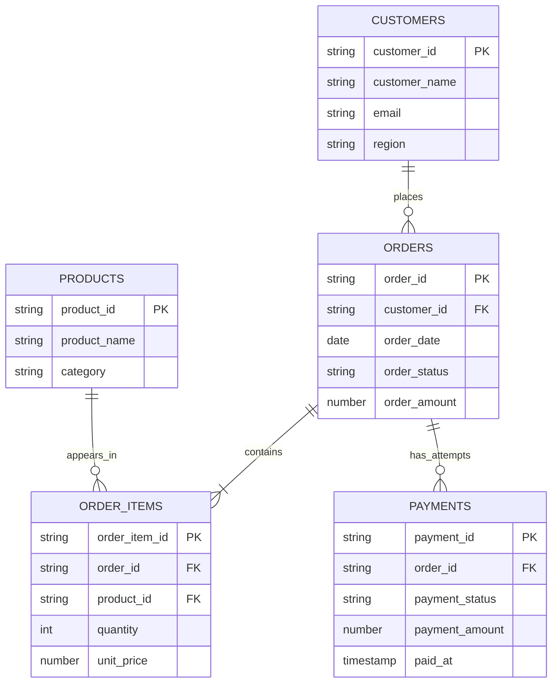
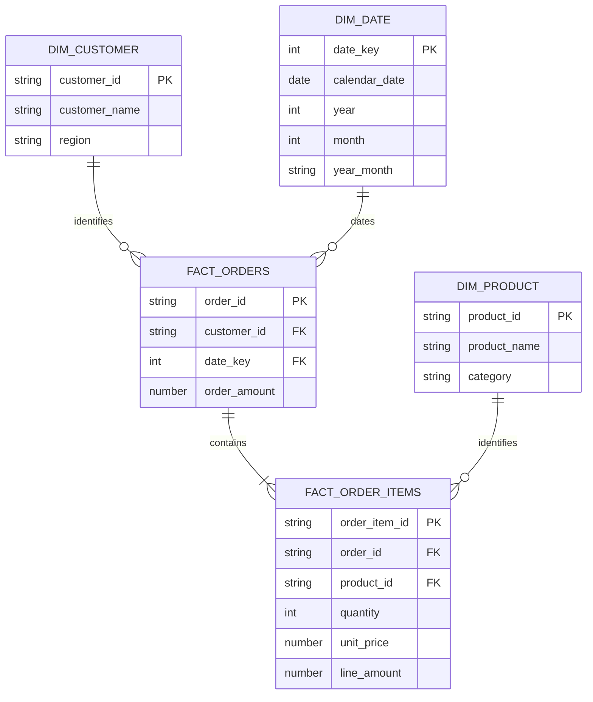

# 데이터 모델 · ERD

## 원천 모델

아래 PK/FK는 업무상 기대하는 관계입니다. 원본 CSV에는 이를 어기는 오류 사례가 있습니다.

주문 한 건에 실패 후 성공한 여러 결제 시도가 있을 수 있습니다. 성공 결제는 최대 1건이라는 교육용 규칙을 사용합니다.

## Snowflake DW

- FACT_ORDERS: 검증된 매출 대상 주문 1건. 주문 수·평균 주문 금액의 기준.
- FACT_ORDER_ITEMS: 해당 주문의 상품 항목 1개. 상품별 판매량·매출 기준.
- 주문과 상세를 조인한 뒤 order_amount를 합산하지 않습니다.
- 원천 결제는 사전 검증에 사용하고 별도 결제 Fact는 이번 범위에 포함하지 않습니다.
- SQL DDL은 NOT NULL을 사용합니다. 키 유일성과 참조 무결성은 ETL 및 `05_validate_dw.sql`에서 명시적으로 검증합니다.
