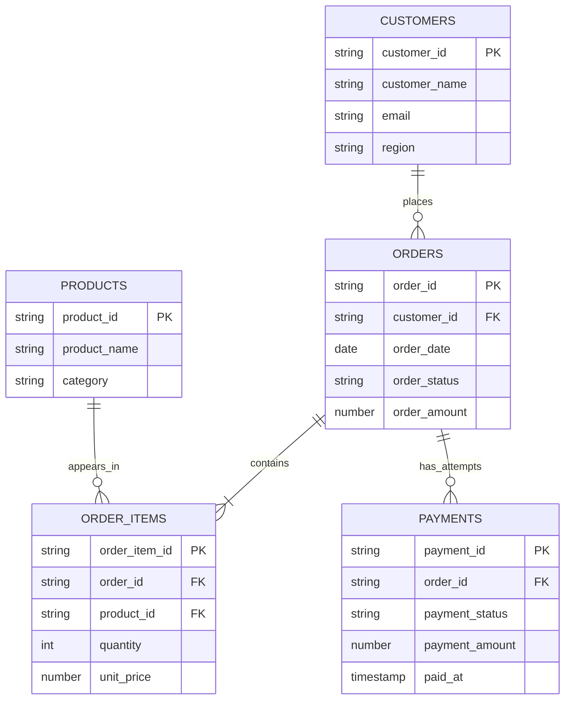
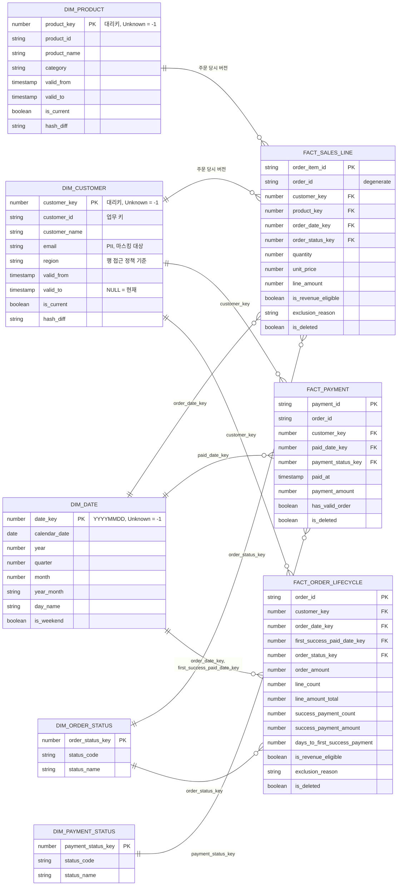

# 데이터 모델 · ERD

데이터는 RAW → CORE → MART 순서로 흐릅니다. 운영 정보는 AUDIT, 보안 설정은 SECURITY 스키마에 둡니다.
테이블 정의는 `sql/00_setup.sql`에 있고, Python(`src/`)은 같은 구조를 로컬에서 계산합니다.

| 스키마 | 역할 | 주요 객체 |
|---|---|---|
| RAW | 원본 CSV를 바꾸지 않고 배치(load_id) 단위로 계속 쌓음. 지우지 않음 | `CUSTOMERS` 등 5개 + `V_*_LATEST`(최근 배치만) |
| CORE | 최근 배치를 정제·검증한 결과. 주문 단위 매출 판정 | `CUSTOMERS`·`PRODUCTS`·`ORDERS`·`ORDER_ITEMS`·`PAYMENTS`, `ORDER_QUALITY`, `SALES_LINE_PREP`, `PAYMENT_PREP`, `RUN_SUMMARY`, `RUN_CTX` |
| MART | 분석용 스타 스키마 (차원 5 + Fact 3) + 리포트 뷰 | 아래 ERD, `V_REVENUE_*` 등 |
| AUDIT | 실행 기록, 데이터 이슈, 품질 검사 결과 | `PIPELINE_RUNS`, `DATA_ISSUES`, `DQ_RESULTS` |
| SECURITY | 역할-지역 매핑, 행 접근 정책, 마스킹 정책 (선택) | `REGION_ACCESS_MAP`, `RAP_CUSTOMER_REGION`, `MASK_EMAIL` |

## 원천 모델 (RAW)

아래 PK/FK는 업무상 기대하는 관계입니다. 원본 CSV에는 이를 어기는 오류 사례가 섞여 있습니다.
RAW 테이블에는 모든 컬럼이 문자열로 들어가고 `load_id`, `loaded_at`, `src_file`, `src_row`가 붙습니다.

## MART 스타 스키마

| 테이블 | 한 행의 의미 (그레인) | 용도 |
|---|---|---|
| FACT_SALES_LINE | 주문 상세 1줄 | 매출·판매 수량·상품/지역 분석의 중심 |
| FACT_PAYMENT | 결제 시도 1건 (실패·대기 포함) | 결제 성공률, 주문 없는 결제 |
| FACT_ORDER_LIFECYCLE | 주문 1건 (누적 스냅샷) | 주문 수, 주문 금액, 결제까지 걸린 일수, 매출 제외 사유 |
| DIM_CUSTOMER / DIM_PRODUCT | 고객·상품의 한 버전 (SCD Type 2) | 주문 당시 지역·상품 정보 |
| DIM_DATE | 2020-01-01 ~ 2030-12-31의 하루 (4,018일 + Unknown) | 매출 없는 날도 0으로 보이는 달력 |

### 설계 규칙

- **대리키와 Unknown 멤버:** Fact는 업무 키 대신 대리키로 차원과 연결합니다. 없는 고객·상품·날짜를 가리키는 행은 버리지 않고 `-1`(Unknown)로 연결합니다.
- **SCD Type 2:** 고객·상품의 속성(`hash_diff`)이 바뀌면 기존 버전에 `valid_to`를 채워 닫고 새 버전을 추가합니다. 처음 보는 고객은 `valid_from = 1900-01-01`로 과거 전체에 유효합니다.
- **Point-in-time 연결:** Fact는 주문일에 유효했던 차원 버전의 대리키를 갖습니다. 그래서 지역별 매출을 "주문 당시 기준(`V_REVENUE_BY_REGION_ASWAS`)"과 "현재 기준(`V_REVENUE_BY_REGION_ASIS`)"으로 따로 볼 수 있습니다.
- **모든 주문 적재 + 매출 플래그:** 대기·취소·오류 주문도 Fact에 들어갑니다. 매출 집계는 `is_revenue_eligible AND NOT is_deleted` 조건으로만 합니다.
- **소프트 삭제:** 이번 스냅샷에서 사라진 행은 지우지 않고 `is_deleted = TRUE`로 표시합니다.
- **헤더 금액은 주문 그레인에만:** `order_amount`는 FACT_ORDER_LIFECYCLE에만 있습니다. 상세와 조인한 뒤 주문 금액을 합산하면 이중 집계가 되기 때문입니다.
- **PK/FK는 선언만:** Snowflake는 PK/FK를 강제하지 않습니다. 키 유일성과 참조 무결성은 `sql/08_mart_dq_checks.sql`의 17개 검사로 확인합니다.

## 리포트 뷰 (`sql/10_report_views.sql`)

모든 매출 뷰는 `DIM_CUSTOMER`와 조인합니다. 행 접근 정책(`sql/11_security.sql`)이 고객 차원에 걸리면 뷰의 매출도 같이 걸러집니다.

| 뷰 | 내용 |
|---|---|
| V_REVENUE_DAILY | 주문일별 주문 수·수량·매출 |
| V_REVENUE_CALENDAR | 첫 주문일 ~ 마지막 주문일의 모든 날 (매출 없는 날 0) |
| V_REVENUE_BY_PRODUCT | 상품별 수량·매출 |
| V_REVENUE_BY_REGION_ASWAS / ASIS | 주문 당시 / 현재 고객 지역별 매출 |
| V_ORDER_QUALITY | 모든 주문의 매출 인식 여부와 제외 사유 |
| V_PAYMENT_SUMMARY | 결제 상태별 시도 수·금액·주문 없는 결제 수 |
| V_SALES_LINE | 매출 인식 라인 단위 (주문일·지역·카테고리·상품). 대시보드 필터용 |
| V_PAYMENT_DAILY | 결제일·지역·상태별 시도 수·금액·주문 없는 결제 수 |
| V_LATEST_RUN | 가장 최근 실행 기록 |
| V_RUN_HISTORY | 실행 이력 + 소요 시간 + 품질 검사 실패 수 (AUDIT 요약) |
| V_DQ_RESULTS / V_DATA_ISSUE_SUMMARY | 실행별 품질 검사 결과 / 이슈 건수 요약 (개별 행·키 값 없음) |

운영 뷰(V_RUN_HISTORY 등)는 AUDIT 테이블 권한 없이 대시보드가 실행 상태를 보여 주기 위한 요약입니다.
