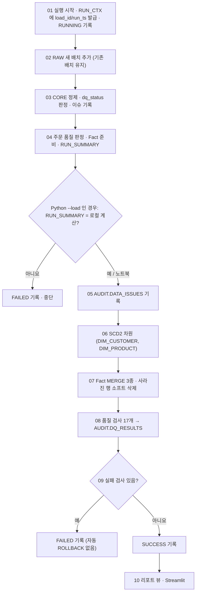

# 파이프라인 실행 순서

같은 로직을 세 가지 방법으로 실행할 수 있습니다. 모두 `sql/` 파일(= 노트북 셀)과 같은 규칙을 따르며 결과도 같습니다.

| 방법 | 어디서 | RAW 적재 | 이후 단계 |
|---|---|---|---|
| Snowflake Notebook | `notebooks/ae101_enterprise_walkthrough.ipynb` | Git 저장소 스테이지 (`sql/02`) | 셀을 위에서 아래로 실행 |
| Python → Snowflake | `python -m src.pipeline --load` | 로컬 CSV를 같은 형태로 INSERT | `sql/03 ~ 10` 파일을 순서대로 실행 |
| Python 로컬 | `python -m src.pipeline --dry-run` | 메모리 | `src/core.py`, `src/mart.py`, `src/reports.py` 가 같은 규칙을 계산 |

MART만 다시 반영하고 싶으면 `notebooks/ae101_mart_etl.ipynb`를 사용합니다 (CORE까지 끝난 뒤).

## 최초 준비

Snowflake에서 `sql/00_setup.sql`(노트북 STEP 1)을 한 번 실행합니다. Python으로는 `python -m src.pipeline --setup`입니다.
DB·스키마, RAW/AUDIT/MART 테이블, 날짜·상태 차원, Unknown 멤버가 만들어집니다. 다시 실행해도 기존 데이터는 유지됩니다.

## 실행 흐름

| 파일 | 노트북 셀 | Python 대응 | 동작 |
|---|---|---|---|
| `00_setup.sql` | step1 | `--setup` | DDL (한 번) |
| `01_start_run.sql` | step2 | `load.load()` 시작 | `CORE.RUN_CTX` 생성, 세션 변수 `$load_id`·`$run_ts` |
| `02_load_raw_from_git.sql` | step0_fetch, step3 | `load.insert_raw()` | RAW에 배치 추가 |
| `03_core_clean.sql` | step4 | `core.clean()` | 중복 제거, 키 충돌·형식 오류 격리, 참조 오류 플래그 |
| `04_core_order_quality.sql` | step5 | `core.order_quality()` 등 | 매출 인식 판정, Fact 준비, 요약 |
| `05_audit_issues.sql` | step6 | `report()` 의 `issues` | 이슈를 AUDIT 로 |
| `06_mart_dimensions.sql` | step7_0 ~ 7_1b | `mart.apply_core()` | 컨텍스트 복원·가드, SCD2 |
| `07_mart_facts.sql` | step7_2a ~ 2c | `mart.apply_core()` | Fact MERGE, 소프트 삭제 |
| `08_mart_dq_checks.sql` | step7_3 | `mart.dq_checks()` | 품질 검사 17개 |
| `09_finalize_run.sql` | step7_4 | `mart.run_pipeline()` | SUCCESS / FAILED 확정 |
| `10_report_views.sql` | step8 | `src/reports.py` | 리포트 뷰 |
| `11_security.sql` | step9 | 없음 (Snowflake 전용) | 역할·행 접근·마스킹 정책 |

`tests/test_notebook_sync.py`가 `sql/` 파일과 노트북 셀이 글자 그대로 같은지 검사합니다. 로직을 바꿀 때는 노트북, `sql/`, `src/`를 함께 고치고 테스트를 실행하세요.

## 입력 계약

한 번의 입력은 **전체 기간·5개 파일 전체의 스냅샷**입니다. 증분 파일만 넣으면 빠진 행이 모두 소프트 삭제됩니다.
RAW는 배치를 계속 쌓고, CORE는 테이블별 가장 최근 배치(`V_*_LATEST`)만 읽습니다. 그래서 고객 파일만 새로 넣으면 다른 파일은 직전 배치를 그대로 씁니다 (노트북 STEP 11의 SCD2 체험이 이 방식입니다).

## 오류와 복구

- **행 오류:** 완전 중복은 제거(REMOVED), 판단할 수 없는 행은 격리(QUARANTINED), 참조 오류는 적재 후 표시(FLAGGED)합니다. 다른 정상 주문은 계속 처리합니다.
- **파일·헤더 오류:** 추출 단계에서 즉시 실패합니다 (`src/extract.py`).
- **매출 주문 0건:** Python `--load`는 기본으로 중단합니다. 의도한 경우에만 `--allow-empty`를 씁니다. 노트북은 7-0 가드 셀 결과를 보고 판단합니다.
- **품질 검사 실패:** MART 반영은 셀(파일) 단위라 자동으로 되돌리지 않습니다. 상태가 `FAILED`로 남으므로 원인을 고친 뒤 06부터 다시 실행합니다. 되돌려야 하면 Time Travel(`... CLONE ... AT(TIMESTAMP => <run_ts>)`)을 씁니다.
- **강제 종료:** `RUNNING` 상태가 남을 수 있습니다. AUDIT와 MART를 먼저 조회한 뒤 01부터 다시 실행합니다.

## 멱등성

- 같은 입력을 다시 실행하면 SCD2 새 버전이 생기지 않고 Fact의 업무 값도 같습니다. `load_id`·`updated_at`만 바뀝니다.
- 행 순서를 바꾸거나 모든 행을 중복시켜도 매출과 MART 업무 값이 같습니다 (`tests/test_rerun.py`).
- RAW·AUDIT는 실행마다 행이 늘어납니다. 교육이 끝나면 전용 DB를 정리하세요.
- 동시 실행은 지원하지 않습니다. `CORE.RUN_CTX`는 가장 최근 실행 하나만 담습니다.
