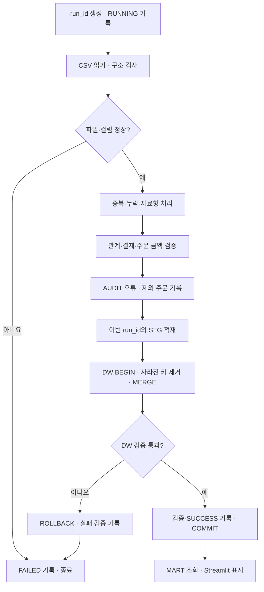

# 파이프라인 실행 순서

## 최초 준비

README에 따라 전용 DB/warehouse/인증을 준비하고 SQL 01 → 02 → 06을 실행합니다. DDL은 DW 게시 트랜잭션 밖에서 수행합니다.

| 단계 | 코드 | 동작 |
|---|---|---|
| 추출 | extract.py | 5개 파일의 필수 컬럼과 CSV 행 구조 검사 |
| 정제 | transform.py | 완전 중복 제거, 키 충돌 격리, 타입·필수값 검사 |
| 검증 | validate.py | 참조, 주문 상태, 단일 성공 결제, 주문·상세·결제 금액 검증 |
| 모델 | build_dw | 검증된 주문과 상세 및 차원 구성 |
| 기록 | audit.py | 오류/중복 이벤트·제외 주문 및 실행별 요약 |
| STG | load.py | run_id로 분리하여 적재; 고유 업무 키 확인 |
| 게시 | load.py + SQL 03/04 | 트랜잭션 안에서 stale key 제거 후 차원 → Fact MERGE |
| 사후 검사 | SQL 05 | 중복·NULL·관계·금액 검사 |
| 확정 | load.py | 검증 결과와 SUCCESS 기록까지 같은 트랜잭션으로 COMMIT |

## 입력 계약

한 번의 입력은 **전체 기간·전체 5개 파일의 스냅샷**입니다. 오늘의 신규 주문만 전달하는 증분 파일로 실행하면 과거 DW 행이 제거됩니다.
같은 키의 변경은 최신 스냅샷 값으로 갱신하고, 지금 스냅샷에서 빠졌거나 검증에서 제외된 키는 DW에서도 제거합니다.
STG의 오래된 실행은 남아도 MERGE/DELETE에서 현재 run_id만 참조합니다.

## 오류와 복구

- 행 오류: 해당 행 및 영향을 받는 주문을 분리하고 다른 정상 주문을 처리합니다.
- 파일/컬럼 오류: STG/DW 게시 전에 실패합니다. 인증·AUDIT 접근 자체가 실패하면 원격 로그를 남기지 못할 수 있습니다.
- 정상 주문 0건: 기본적으로 중단합니다. 의도한 빈 결과인지 확인 후 `--allow-empty`로 명시적으로 실행합니다.
- DW 검사 실패: 같은 연결에서 ROLLBACK하고 실패한 검사 결과를 트랜잭션 밖에 남깁니다.
- 실패 후: 원본 오류를 새 스냅샷에서 수정하고 전체 파이프라인을 재실행합니다. 기존 원본 파일은 버전 관리로 추적합니다.
- 연결 단절로 COMMIT 성공 여부를 알 수 없다면 AUDIT와 DW를 먼저 조회합니다. 자동으로 데이터가 롤백되었다고 단정하지 않습니다.
- UI 품질 상태는 최근 실행 기준, 매출은 마지막으로 확정된 DW 기준입니다. 동시에 여러 실행/게시 중 대시보드 조회는 피하는 개인 실습 구조입니다.

## 멱등성 검증

1. 동일 입력으로 `--load`를 두 번 실행합니다.
2. SQL 05의 failures가 모두 0인지 확인합니다.
3. DW 전체 테이블을 키 기준으로 비교하여 행 수뿐 아니라 업무 값도 같은지 확인합니다.
4. 파일 행 순서 변경·완전 중복 추가에도 매출이 유지되는지 검사합니다.
5. AUDIT/STG 행 수는 실행별로 증가할 수 있습니다.
