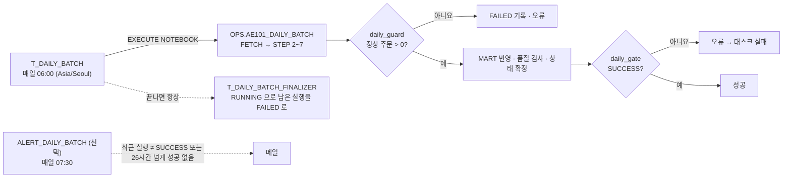

# 매일 배치 스케줄링

워크스루 노트북은 사람이 셀을 위에서 아래로 실행하는 학습용 흐름입니다. 이 문서는 같은 파이프라인을 Snowflake 안에서 매일 자동으로 돌리는 방법을 설명합니다.
설치 코드는 `orchestration/daily_schedule.sql`(필수)과 `orchestration/daily_alert.sql`(선택), 매일 실행되는 코드는 `notebooks/ae101_daily_batch.ipynb` 입니다.

## 1. 매일 다시 실행할 단계와 한 번만 실행할 단계

매일 배치에 넣는 것은 **STEP 2 ~ STEP 7** 뿐입니다. DDL·뷰·보안은 처음 한 번, 또는 정의가 바뀔 때만 실행합니다.

| 단계 | 파일 | 매일? | 근거 |
|---|---|---|---|
| STEP 0 FETCH | `sql/02` 앞부분 | 예 | Git 저장소의 최신 CSV를 읽으려면 매번 FETCH가 필요합니다. `USE ROLE` 은 빼고 `daily_prepare` 셀에서 실행합니다. |
| STEP 0 웨어하우스 확인 | (노트북 전용) | 아니요 | 사람이 확인하는 셀입니다. 태스크는 노트북의 `QUERY_WAREHOUSE` 를 씁니다. |
| STEP 1 DDL | `sql/00_setup.sql` | **아니요** | 아래 설명 참고 |
| STEP 2 ~ 6 | `sql/01` ~ `05` | 예 | 새 `load_id` 발급, RAW 새 배치, CORE 재계산, 이슈 기록. CORE 테이블은 매번 `CREATE OR REPLACE` 되는 작업 테이블입니다. |
| STEP 7 | `sql/06` ~ `09` | 예 | SCD2·Fact MERGE·소프트 삭제·품질 검사·상태 확정. 같은 입력이면 MART 업무 값이 바뀌지 않습니다 (`test_same_input_twice_is_idempotent`). |
| STEP 8 리포트 뷰 | `sql/10` | **아니요** | 뷰는 조회할 때 MART를 읽으므로 데이터가 바뀌어도 다시 만들 필요가 없습니다. 뷰 정의를 바꿀 때만 실행합니다. |
| STEP 9 보안 | `sql/11` | **아니요** | 역할·정책은 한 번 만들면 유지됩니다. `USE ROLE` 로 역할을 바꾸며 검증하는 셀이라 태스크에서 실행할 수도 없습니다. |
| STEP 10 확인 | (노트북 전용) | 아니요 | 사람이 결과를 보는 SELECT 입니다. |
| STEP 11 SCD2 체험 | (노트북 전용) | **절대 아니요** | C002 지역을 부산으로 바꾼 가짜 배치를 RAW에 넣는 실습입니다. |
| STEP 12 정리 | (노트북 전용) | 아니요 | DB 삭제 주석입니다. |

**STEP 1을 매일 실행하지 않아도 되는 이유와, 실행하면 안 되는 이유**

STEP 1의 테이블은 대부분 `CREATE TABLE IF NOT EXISTS` 라서 다시 실행해도 데이터는 그대로입니다. Unknown 멤버(-1)도 없을 때만 넣습니다. 그래서 한 번 만든 뒤에는 매일 실행할 이유가 없습니다.
게다가 일부 객체는 `CREATE OR REPLACE` 로 다시 만들어집니다. `MART.DIM_DATE`, `DIM_ORDER_STATUS`, `DIM_PAYMENT_STATUS`, `RAW.CSV_FORMAT`, `RAW.V_*_LATEST` 입니다.
다시 만들어진 객체에서는 STEP 9가 준 권한이 사라집니다. 특히 `GRANT SELECT ON TABLE MART.DIM_DATE` 가 사라져 분석가 역할이 날짜 차원을 직접 조회하지 못하게 됩니다.
따라서 STEP 1은 처음 한 번만 실행하고, 스키마를 바꿀 때에만 변경 배포로 실행합니다.

**한 번만 실행하는 단계에 남는 유지보수 항목**

- `DIM_DATE` 는 2030-12-31까지입니다. 이후 주문은 날짜 키가 -1이 되어 품질 검사(`revenue_requires_known_keys`)가 실패하고 배치가 `FAILED` 로 끝납니다. 2030년 안에 달력을 늘리세요.
- STEP 8을 다시 실행해도 STEP 9의 `FUTURE VIEWS` 권한 덕분에 분석가·관리자 역할의 뷰 조회 권한은 유지됩니다.

## 2. Snowflake 안의 스케줄러 비교

| 방식 | 장점 | 이 프로젝트에서의 문제 | 판단 |
|---|---|---|---|
| **Task Graph + `EXECUTE NOTEBOOK`** | 노트북 셀이 지금과 같은 한 세션에서 실행되어 `$load_id` 세션 변수가 그대로 동작합니다. 파이널라이저로 실패 정리, `TASK_HISTORY` 로 이력, 동시 실행 방지가 기본입니다. | 노트북 객체는 배포 시점의 사본이라, 노트북을 고치면 다시 배포해야 합니다. | **채택** |
| Snowsight 노트북 Schedule 버튼 | 클릭 몇 번으로 끝납니다. 내부적으로 태스크를 만듭니다. | 워크스루 노트북을 그대로 예약하면 STEP 1·9·11까지 매일 실행됩니다. 실패 정리 단계를 붙일 수 없습니다. | 일일 노트북에 쓰면 간단한 대안 |
| 태스크마다 `EXECUTE IMMEDIATE FROM @repo/.../sql/0N.sql` | 단계별 상태·재시도가 보입니다. | 태스크마다 세션이 달라 `$load_id` 가 이어지지 않습니다. `sql/02`·`05`·`07`·`08`·`09` 는 앞 세션의 변수에 기대고, `sql/02` 에는 `USE ROLE` 이 있습니다. 파일을 고쳐야 합니다. | 보류 |
| 저장 프로시저 + 태스크 | 오류 처리를 코드로 세밀하게 할 수 있습니다. | 소유자 권한 프로시저는 세션 변수를 설정·조회할 수 없어 로직을 다시 써야 합니다. | 보류 |
| Dynamic Table | 선언만 하면 갱신됩니다. | SCD2 UPDATE, MERGE 소프트 삭제, AUDIT 기록, 품질 게이트를 표현할 수 없습니다. | 부적합 |
| 외부 스케줄러 (GitHub Actions, Airflow) + `python -m src.pipeline --load` | 로컬 계산과 Snowflake 결과를 대사합니다. | Snowflake 밖에 실행 환경과 인증 정보(키페어 등)가 필요합니다. | Snowflake 밖에서 돌릴 때의 대안 |

## 3. 구성

| 객체 | 위치 | 역할 |
|---|---|---|
| `AE101_DAILY_BATCH` (노트북) | `AE101_SALES_ENT.OPS` | Git `main` 의 `notebooks/ae101_daily_batch.ipynb` 사본. 워크스루 STEP 2~7 셀 + 가드·게이트 셀 |
| `T_DAILY_BATCH` (루트 태스크) | `AE101_SALES_ENT.OPS` | 매일 06:00 노트북 실행. 1시간 제한, 3회 연속 실패 시 자동 정지, 자동 재시도 없음 |
| `T_DAILY_BATCH_FINALIZER` | `AE101_SALES_ENT.OPS` | 루트 태스크의 성공·실패와 관계없이 마지막에 실행. 이번 `load_id` 가 `RUNNING` 이면 `FAILED` 로 닫음 |
| `ALERT_DAILY_BATCH` (선택) | `AE101_SALES_ENT.OPS` | 최근 실행이 `SUCCESS` 가 아니거나 26시간 넘게 성공이 없으면 메일 |

**실패는 세 겹으로 드러납니다.** 정상 주문이 0건이면 `daily_guard` 가 `FAILED` 를 기록하고 멈춥니다. 품질 검사가 실패하면 STEP 7-4가 `FAILED` 를 기록하고, `daily_gate` 가 오류를 내 태스크도 실패로 표시됩니다. 중간 셀 오류로 `RUNNING` 이 남으면 파이널라이저가 닫습니다.
어느 경우든 MART는 자동으로 되돌리지 않습니다. 이는 워크스루와 같은 정책이며, 필요하면 Time Travel로 복구합니다.

**자동 재시도를 끈 이유.** 재시도하면 새 `load_id` 로 RAW 배치가 하나 더 쌓입니다. 품질 검사 실패처럼 데이터 때문에 생긴 실패는 다시 돌려도 같은 결과가 나옵니다. 일시적인 오류로 실패했다면 원인을 확인한 뒤 `EXECUTE TASK` 로 한 번 더 실행하세요.

## 4. 설치

1. `notebooks/ae101_daily_batch.ipynb` 가 GitHub `main` 에 있는지 확인합니다.
2. `orchestration/daily_schedule.sql` 에서 `COMPUTE_WH` 3곳을 실제 웨어하우스 이름으로 바꾸고(`SHOW WAREHOUSES;`), 필요하면 시간대를 바꿉니다.
3. 파이프라인 객체를 소유한 역할(교육용 기본: ACCOUNTADMIN)로 파일 전체를 실행합니다. 마지막 `SHOW TASKS` 에서 두 태스크가 `started` 인지 확인합니다.
4. `EXECUTE TASK AE101_SALES_ENT.OPS.T_DAILY_BATCH;` 로 한 번 바로 실행합니다. 몇 분 뒤 `MART.V_RUN_HISTORY` 맨 위가 `SUCCESS` 인지 봅니다.
5. (선택) `orchestration/daily_alert.sql` 의 메일 주소와 웨어하우스를 바꿔 실행합니다.

필요한 권한은 계정의 `EXECUTE TASK`, `OPS` 스키마의 `CREATE NOTEBOOK`·`CREATE TASK`, 웨어하우스 `USAGE` 입니다. 알림을 쓰면 `EXECUTE ALERT` 와 `CREATE ALERT` 도 필요합니다. 노트북 소유 역할과 태스크 소유 역할은 같아야 합니다(`EXECUTE NOTEBOOK` 은 노트북 소유자만 실행할 수 있음).
운영 환경에서는 ACCOUNTADMIN 대신 파이프라인 전용 역할에 `AE101_SALES_ENT` 객체 소유권을 넘기고 그 역할로 설치하세요.

## 5. 운영

| 하고 싶은 일 | 방법 |
|---|---|
| 지금 한 번 실행 | `EXECUTE TASK AE101_SALES_ENT.OPS.T_DAILY_BATCH;` |
| 태스크 이력 | `SELECT * FROM TABLE(AE101_SALES_ENT.INFORMATION_SCHEMA.TASK_HISTORY(TASK_NAME => 'T_DAILY_BATCH'));` |
| 파이프라인 결과 | `MART.V_RUN_HISTORY`, Streamlit "데이터 운영" 탭 |
| 실패한 셀 찾기 | Snowsight → Notebooks → `AE101_DAILY_BATCH` → 실행 이력 |
| 워크스루를 직접 실습 | 먼저 `ALTER TASK AE101_SALES_ENT.OPS.T_DAILY_BATCH SUSPEND;` (두 실행이 `CORE.RUN_CTX` 를 덮어쓰지 않게) |
| 노트북 로직 변경 배포 | 워크스루 수정 → `python scripts/build_daily_notebook.py` → 테스트 → `main` 푸시 → `daily_schedule.sql` 2단계(FETCH·CREATE NOTEBOOK·ADD LIVE VERSION) 다시 실행 |
| 스키마·뷰 변경 배포 | 스케줄 멈춤 → 바뀐 STEP 1 또는 STEP 8 실행 → 위의 노트북 배포 → 스케줄 다시 켜기 |
| 3회 연속 실패로 정지됨 | 원인 수정 후 `ALTER TASK ... RESUME;` |

## 6. 범위와 한계

- 매일 배치는 기본으로 Snowflake 안에서 새 무작위 데이터를 만들어 스테이지 `@RAW.LANDING/current/`에 올린 뒤 적재합니다(`daily_source` 셀의 `landing_source = 'random'`). 매번 완전히 새 데이터셋이므로 같은 ID의 고객·주문 내용이 통째로 바뀌어 SCD2 버전과 Fact 변경이 많이 생기고, RAW에는 하루 약 13만 행씩 쌓입니다. 오래된 RAW 배치와 `@RAW.LANDING/batches/`의 보관 기간을 정하세요.
- 배치마다 심은 오류의 정답은 `@RAW.LANDING/batches/<load_id>/answer_key.json`에 남습니다. 매일 같은 Git 데이터를 다시 적재하려면 `scripts/build_daily_notebook.py`의 `DAILY_LANDING_SOURCE`를 `'git'`으로 바꾸고 노트북을 다시 만들어 배포하세요.
- 노트북 실행에서 오류 셀 이후가 멈추는 동작은 Snowflake의 노트북 실행 방식을 따릅니다. 이 경우에도 파이널라이저가 기록을 `FAILED` 로 닫습니다.
- 이 저장소에서는 파일 구조·셀 순서·가드·게이트·파이널라이저·알림 조건을 로컬에서 검사했습니다. 실제 Snowflake에서 태스크를 실행해 본 것은 아닙니다. [검증 결과](validation_results.md)를 보세요.
