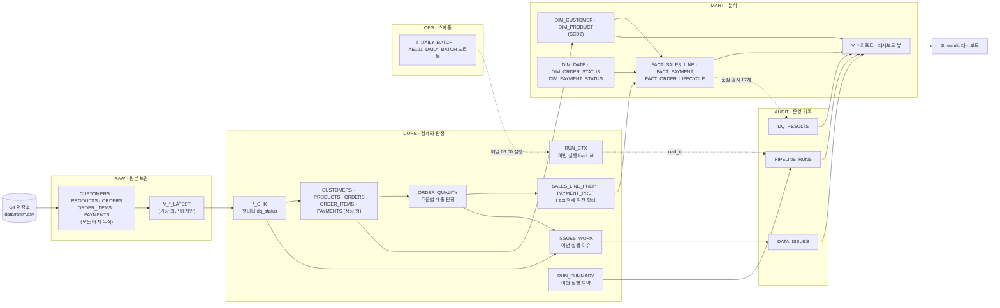
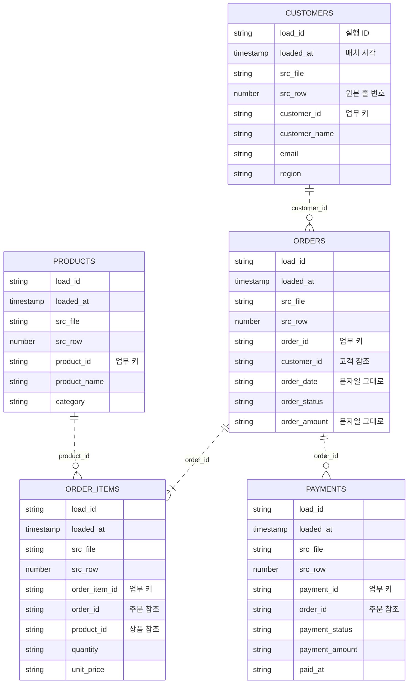
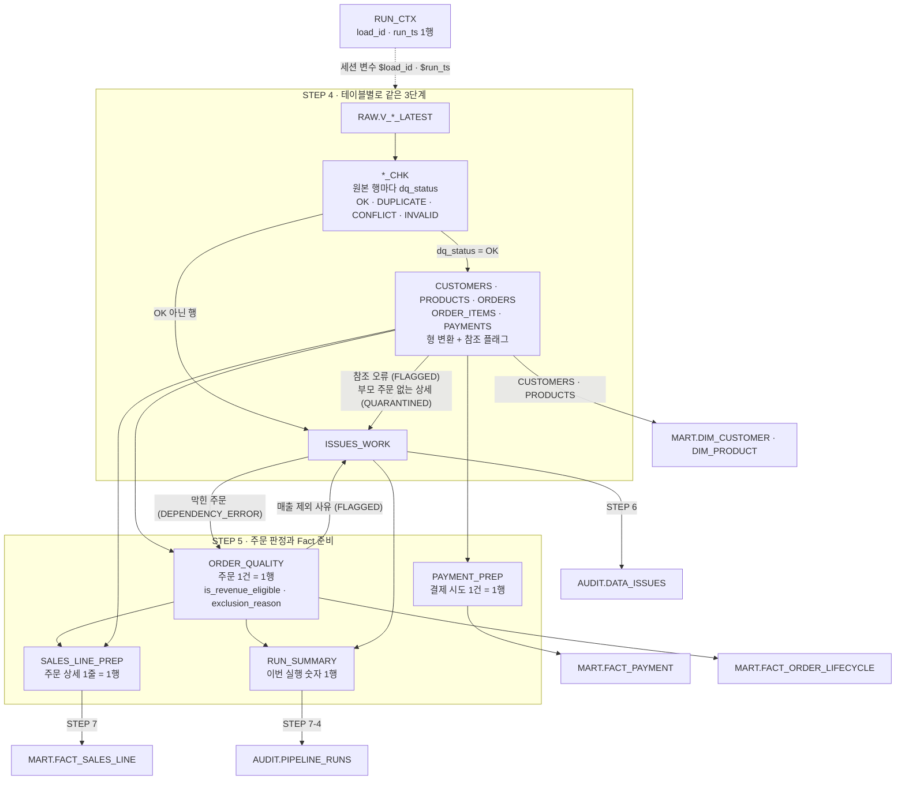
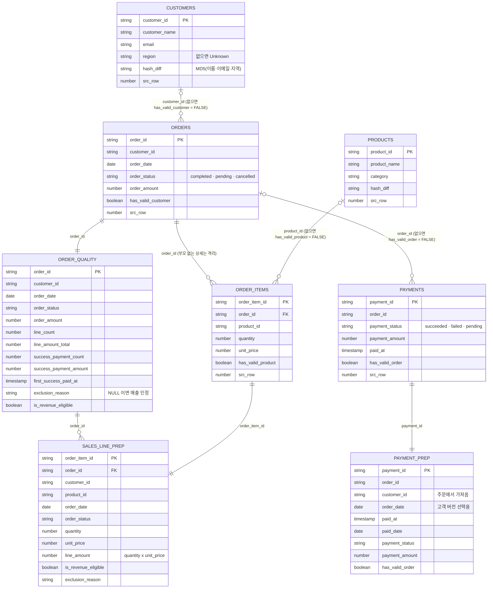
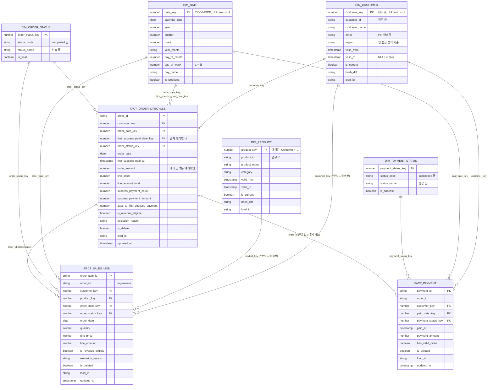
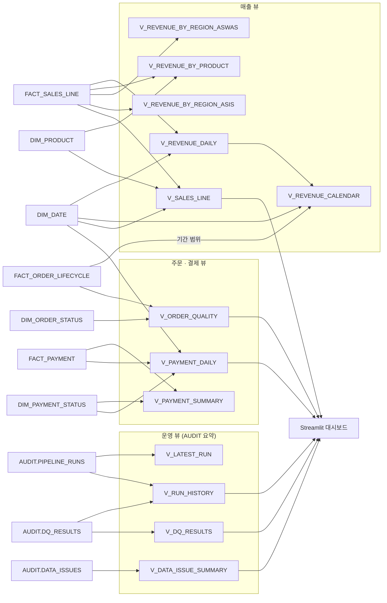
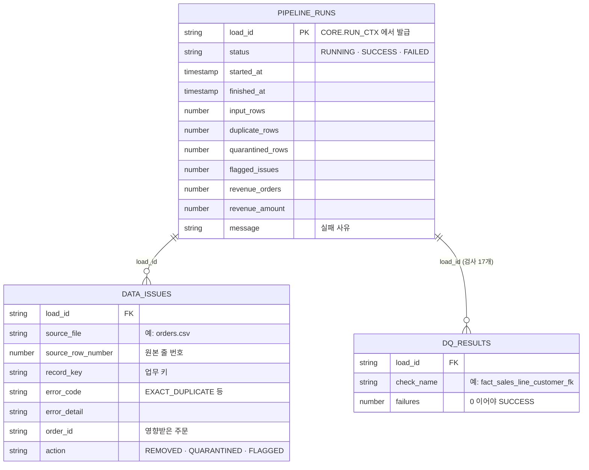
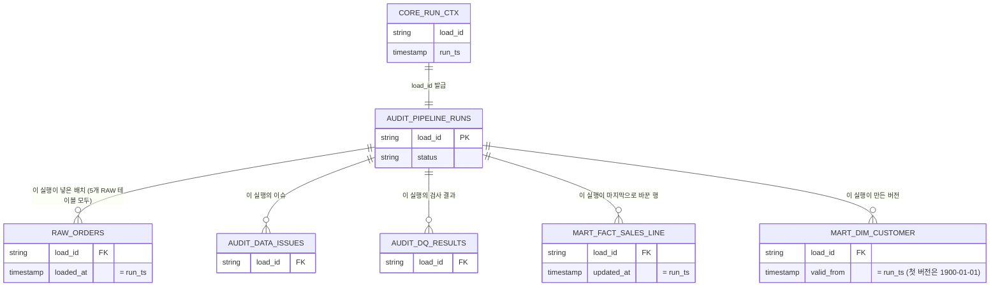
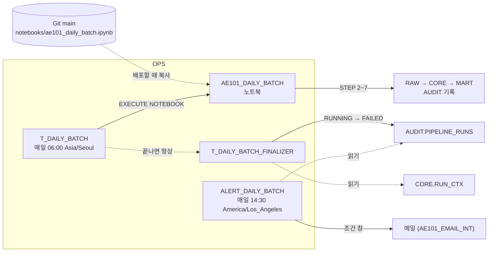

# AE101_SALES_ENT 스키마별 테이블 · 뷰 안내

`AE101_SALES_ENT` 데이터베이스에 만들어지는 모든 테이블·뷰·운영 객체가 **무슨 역할을 하고 서로 어떻게 연결되는지**를 스키마 순서대로 설명합니다.
객체 정의는 `sql/00_setup.sql` ~ `sql/11_security.sql`(= 워크스루 노트북 셀)과 `orchestration/daily_schedule.sql`·`daily_alert.sql` 에 있습니다. 설계 원칙(대리키, SCD2, 그레인)은 [데이터 모델 · ERD](erd.md), 컬럼 뜻은 [데이터 사전](data_dictionary.md)을 함께 보세요.

행 수는 예제 데이터(`data/raw`)로 **처음 한 번 실행한 직후** 기준입니다. RAW·AUDIT 는 실행할 때마다 늘어나고, CORE 는 매번 새로 만들어지며, MART 는 같은 입력이면 그대로입니다.

## 1. 전체 그림

| 스키마 | 한 줄 역할 | 테이블 | 뷰 | 기타 객체 | 갱신 방식 |
|---|---|---:|---:|---|---|
| RAW | 원본 CSV를 바꾸지 않고 배치 단위로 쌓는 보관소 | 5 | 5 | 파일 포맷 1 | 실행마다 **추가(append)** |
| CORE | 최근 배치를 정제하고 주문별 매출 인정 여부를 판정하는 작업 공간 | 16 | 0 | | 실행마다 **새로 만듦(replace)** |
| MART | 분석용 스타 스키마와 리포트·대시보드 뷰 | 8 | 13 | 시퀀스 2 | 차원 **SCD2**, Fact **MERGE + 소프트 삭제** |
| AUDIT | 실행 기록, 데이터 이슈, 품질 검사 결과 | 3 | 0 | | 실행마다 **추가**, 상태는 UPDATE |
| OPS | 매일 배치 스케줄러 | 0 | 0 | 노트북 1, 태스크 2, 알림 1 | 배포할 때만 바뀜 |
| SECURITY (참고) | 역할별 지역 제한과 이메일 마스킹 | 1 | 0 | 정책 2 | 한 번 설정 |

**모든 스키마를 꿰는 열쇠는 `load_id`** 입니다. 실행이 시작될 때 `CORE.RUN_CTX` 에 하나 발급되고, 그 실행이 RAW에 넣은 행, AUDIT 의 세 테이블, MART 에서 그 실행이 바꾼 행에 같은 값이 기록됩니다. 그래서 "이 숫자는 어느 실행에서 왔나"를 언제든 거꾸로 추적할 수 있습니다.

## 2. RAW : 원본 보관

원본 CSV 5개를 **글자 그대로(모든 컬럼 VARCHAR)** 저장합니다. 형 변환·정제를 하지 않기 때문에 잘못된 값도 그대로 남고, 나중에 "원본에는 뭐라고 되어 있었나"를 확인할 수 있습니다.
실행마다 새 배치가 추가될 뿐 지우거나 고치지 않습니다. 모든 행에 네 개의 메타 컬럼이 붙습니다.

| 메타 컬럼 | 뜻 |
|---|---|
| `load_id` | 이 행을 넣은 실행 (`AUDIT.PIPELINE_RUNS.load_id`) |
| `loaded_at` | 적재 시각 = 그 실행의 `run_ts`. `V_*_LATEST` 가 최근 배치를 고를 때 씁니다 |
| `src_file` | 원본 파일 이름 |
| `src_row` | 원본 파일의 줄 번호 (헤더 = 1). 이슈를 원본 줄까지 추적할 때 씁니다 |

| 객체 | 종류 | 한 행의 의미 | 역할 | 1회 실행 후 행 수 | 만드는 곳 |
|---|---|---|---|---:|---|
| `CUSTOMERS` | 테이블 | 고객 CSV 한 줄 | 고객 원본 | 2,028 | STEP 1 생성, STEP 3 적재 |
| `PRODUCTS` | 테이블 | 상품 CSV 한 줄 | 상품 원본 | 151 | 〃 |
| `ORDERS` | 테이블 | 주문 CSV 한 줄 | 주문 헤더 원본 | 30,081 | 〃 |
| `ORDER_ITEMS` | 테이블 | 주문 상세 CSV 한 줄 | 주문 상세 원본 | 66,262 | 〃 |
| `PAYMENTS` | 테이블 | 결제 시도 CSV 한 줄 | 결제 시도 원본 | 31,096 | 〃 |
| `V_CUSTOMERS_LATEST` · `V_PRODUCTS_LATEST` · `V_ORDERS_LATEST` · `V_ORDER_ITEMS_LATEST` · `V_PAYMENTS_LATEST` | 뷰 | 위와 같음 | 각 테이블에서 `loaded_at` 이 가장 큰 배치만 보여 줌. **CORE 는 항상 이 뷰를 읽습니다** | 테이블과 같음 | STEP 1 |
| `CSV_FORMAT` | 파일 포맷 | | Git 스테이지의 CSV 를 읽는 규칙 (헤더 1줄 건너뜀, UTF-8) | | STEP 1 |

아래 관계는 **업무상 기대하는 관계**입니다. RAW 는 이를 강제하지 않으며, 실제 데이터에는 이를 어기는 행(없는 고객의 주문, 주문 없는 결제 등)이 섞여 있습니다. 그래서 점선으로 그렸습니다.

## 3. CORE : 정제와 매출 판정

CORE 는 **이번 실행 한 번을 위한 작업 공간**입니다. 모든 테이블이 실행마다 `CREATE OR REPLACE` 로 새로 만들어지므로 이력은 남지 않습니다. 이력은 RAW(원본)와 AUDIT(이슈·결과)에 남습니다.
분석가 역할에는 권한을 주지 않는 내부 계층입니다.

### 3-1. 처리 흐름

### 3-2. 테이블 역할

| 테이블 | 한 행의 의미 | 역할 | 행 수 | 다음에 쓰는 곳 |
|---|---|---|---:|---|
| `RUN_CTX` | 이번 실행 (항상 1행) | `load_id`(UUID)와 `run_ts` 발급. 노트북이 재시작돼도 여기서 세션 변수를 복원 | 1 | 모든 STEP, OPS 파이널라이저 |
| `CUSTOMERS_CHK` | RAW 최근 배치의 고객 한 줄 | 공백 정리 후 `dq_status` 판정 (완전 중복 / 같은 키 다른 내용 / 필수값·형식 오류 / 정상) | 2,028 | `CUSTOMERS`, `ISSUES_WORK` |
| `PRODUCTS_CHK` | 상품 한 줄 | 〃 | 151 | `PRODUCTS`, `ISSUES_WORK` |
| `ORDERS_CHK` | 주문 한 줄 | 〃 + 날짜·금액·상태값 검사 | 30,081 | `ORDERS`, `ISSUES_WORK` |
| `ORDER_ITEMS_CHK` | 주문 상세 한 줄 | 〃 + 수량·단가 검사 | 66,262 | `ORDER_ITEMS`, `ISSUES_WORK` |
| `PAYMENTS_CHK` | 결제 시도 한 줄 | 〃 + 상태값·시각 검사 | 31,096 | `PAYMENTS`, `ISSUES_WORK` |
| `CUSTOMERS` | 정상 고객 1명 | `region` 없으면 `'Unknown'`, 변경 감지용 `hash_diff`(MD5) | 1,997 | `MART.DIM_CUSTOMER` (SCD2) |
| `PRODUCTS` | 정상 상품 1개 | `hash_diff` 계산 | 150 | `MART.DIM_PRODUCT` (SCD2) |
| `ORDERS` | 정상 주문 1건 | 날짜·금액 형 변환. 고객이 없으면 `has_valid_customer = FALSE` (적재하되 표시) | 29,802 | `ORDER_QUALITY`, `PAYMENT_PREP` |
| `ORDER_ITEMS` | 정상 주문 상세 1줄 | 부모 주문이 없는 줄은 여기서 빠짐(격리). 상품이 없으면 `has_valid_product = FALSE` | 65,789 | `ORDER_QUALITY`, `SALES_LINE_PREP` |
| `PAYMENTS` | 정상 결제 시도 1건 | 주문이 없으면 `has_valid_order = FALSE` (주문 없는 결제) | 30,966 | `ORDER_QUALITY`, `PAYMENT_PREP` |
| `ISSUES_WORK` | 이슈 1건 | 이번 실행의 모든 이슈. `action` = REMOVED 473 / QUARANTINED 441 / FLAGGED 559 | 1,473 | `AUDIT.DATA_ISSUES`, `RUN_SUMMARY`, `ORDER_QUALITY` |
| `ORDER_QUALITY` | 주문 1건 | 상세 합계·성공 결제 수·금액을 모아 **매출 인정 여부**와 제외 사유를 한 번에 판정 | 29,802 | `FACT_ORDER_LIFECYCLE`, `SALES_LINE_PREP`, `RUN_SUMMARY` |
| `SALES_LINE_PREP` | 주문 상세 1줄 | 상세에 주문의 고객·주문일·판정 결과를 붙인 Fact 직전 형태 (키는 아직 업무 키) | 65,789 | `FACT_SALES_LINE` |
| `PAYMENT_PREP` | 결제 시도 1건 | 결제에 주문의 고객·주문일을 붙임. 주문 없는 결제도 포함 | 30,966 | `FACT_PAYMENT` |
| `RUN_SUMMARY` | 이번 실행 (1행) | 입력 행·중복·격리·플래그·매출 주문 수·매출액 | 1 | `AUDIT.PIPELINE_RUNS`, Python `--load` 대사 |

`*_CHK` 와 정제 테이블의 관계는 단순합니다. **정제 테이블 = `*_CHK` 에서 `dq_status = 'OK'` 인 행 + 형 변환 + 참조 플래그**입니다. 정상(OK)이 아닌 행은 정제 테이블에 들어가지 않고 `ISSUES_WORK` 에만 남습니다.

### 3-3. 정제 테이블 사이의 관계

정제를 거치면 키 유일성은 보장되지만, 참조 오류는 "버리지 않고 표시"하는 정책이라 부모가 없을 수 있습니다(`|o` = 0 또는 1).

**매출 인정 규칙 (`ORDER_QUALITY.exclusion_reason`)** 은 위에서부터 처음 걸리는 사유 하나를 기록합니다. 아무것도 걸리지 않으면 매출로 인정합니다(27,055건).

| 순서 | 사유 | 조건 | 주문 수 |
|---|---|---|---:|
| 1 | `DEPENDENCY_ERROR` | 주문 또는 그 상세·결제에 격리·참조 오류 이슈가 있음 | 284 |
| 2 | `NOT_COMPLETED` | 주문 상태가 completed 가 아님 | 2,190 |
| 3 | `SUCCESS_PAYMENT_COUNT` | 성공 결제가 정확히 1건이 아님 | 101 |
| 4 | `MISSING_ITEMS` | 주문 상세가 없음 | 31 |
| 5 | `AMOUNT_MISMATCH` | 주문 금액 = 상세 합계 = 성공 결제 금액이 아님 | 141 |

## 4. MART : 분석용 스타 스키마

MART 는 분석가·대시보드가 읽는 계층입니다. 차원 5개와 Fact 3개 테이블, 이를 미리 조인·집계한 뷰 13개로 이루어집니다.
**Fact 는 업무 키 대신 대리키로 차원과 연결**하고, 찾지 못한 고객·상품·날짜는 버리지 않고 Unknown(`-1`)에 연결합니다. PK/FK 는 선언만 되어 있고 Snowflake 가 강제하지 않으므로, STEP 7-3의 품질 검사 17개가 키 유일성과 참조 무결성을 대신 확인합니다.

### 4-1. 테이블 역할

| 테이블 | 종류 | 한 행의 의미 (그레인) | 역할 | 갱신 방식 | 행 수 |
|---|---|---|---|---|---:|
| `DIM_CUSTOMER` | 차원 (SCD2) | 고객의 한 버전 | 주문 당시 고객 지역을 보존. 행 접근·마스킹 정책 대상 | 바뀐 고객만 기존 버전 닫고 새 버전 추가 | 1,998 (Unknown 포함) |
| `DIM_PRODUCT` | 차원 (SCD2) | 상품의 한 버전 | 주문 당시 상품명·카테고리 보존 | 〃 | 151 (Unknown 포함) |
| `DIM_DATE` | 차원 (정적) | 하루 (2020-01-01 ~ 2030-12-31) + Unknown | 매출 없는 날도 0으로 보이는 달력, 연·분기·월·요일 속성 | STEP 1 에서 한 번 | 4,019 |
| `DIM_ORDER_STATUS` | 차원 (정적) | 주문 상태 코드 | 영문 코드 → 한글 이름, `is_final` | STEP 1 에서 한 번 | 4 |
| `DIM_PAYMENT_STATUS` | 차원 (정적) | 결제 상태 코드 | 영문 코드 → 한글 이름, `is_success` | STEP 1 에서 한 번 | 4 |
| `FACT_SALES_LINE` | 트랜잭션 Fact | 주문 상세 1줄 | 매출·판매 수량·상품·지역 분석의 중심 | MERGE + 소프트 삭제 | 65,789 |
| `FACT_PAYMENT` | 트랜잭션 Fact | 결제 시도 1건 (실패·대기 포함) | 결제 성공률, 주문 없는 결제 | 〃 | 30,966 |
| `FACT_ORDER_LIFECYCLE` | 누적 스냅샷 Fact | 주문 1건 | 주문 수, 주문 금액(헤더 금액은 여기에만), 결제까지 걸린 일수, 매출 제외 사유 | 〃 | 29,802 |
| `SEQ_CUSTOMER_KEY` · `SEQ_PRODUCT_KEY` | 시퀀스 | | 고객·상품 대리키 발급 | | |

**SCD2 차원과 Fact 의 연결 방법 (point-in-time)**: Fact 를 적재할 때 업무 키(`customer_id`)와 **주문일**로 "그날 유효했던 버전"(`valid_from ≤ 주문일 < valid_to`)을 찾아 그 대리키를 넣습니다.
그래서 고객이 이사해도 과거 주문은 옛 지역 버전에 계속 연결됩니다. 처음 보는 고객은 `valid_from = 1900-01-01` 로 만들어 과거 주문도 모두 찾을 수 있게 합니다.

**소프트 삭제**: 이번 입력에서 사라진 Fact 행은 지우지 않고 `is_deleted = TRUE` 로 표시합니다. 모든 매출 집계는 `is_revenue_eligible AND NOT is_deleted` 조건으로만 합니다.

### 4-2. 스타 스키마 ERD

`FACT_ORDER_LIFECYCLE` 와 다른 두 Fact 의 `order_id` 연결은 선언된 FK 가 아니라 **같은 주문을 가리키는 공통 값(degenerate dimension)** 입니다. 주문 금액을 상세 Fact 와 조인해 더하면 상세 줄 수만큼 중복되므로, 주문 금액은 반드시 `FACT_ORDER_LIFECYCLE` 에서만 집계합니다.

### 4-3. 뷰 (STEP 8, `sql/10_report_views.sql`)

뷰는 조회할 때마다 테이블을 읽으므로 데이터가 바뀌어도 다시 만들 필요가 없습니다. 매출 뷰는 모두 `DIM_CUSTOMER` 와 조인하므로, 행 접근 정책이 걸리면 뷰의 결과도 역할에 따라 같이 걸러집니다.

운영 뷰 4개를 뺀 9개 뷰는 모두 DIM_CUSTOMER 와 조인합니다(`V_REVENUE_CALENDAR` 는 `V_REVENUE_DAILY` 를 거쳐서). 그림이 복잡해지지 않도록 이 화살표는 생략했습니다.

| 뷰 | 한 행의 의미 | 용도 | 행 수 | 대시보드 |
|---|---|---|---:|:---:|
| `V_REVENUE_DAILY` | 매출이 있는 주문일 | 일별 주문 수·수량·매출 | 669 | |
| `V_REVENUE_CALENDAR` | 첫 주문일 ~ 마지막 주문일의 모든 날 | 매출 없는 날도 0으로 표시 | 669 | |
| `V_REVENUE_BY_PRODUCT` | 상품 | 상품별 수량·매출 | 150 | |
| `V_REVENUE_BY_REGION_ASWAS` | 지역 (주문 당시) | 주문 당시 고객 지역 기준 매출 | 18 | |
| `V_REVENUE_BY_REGION_ASIS` | 지역 (현재) | 고객의 현재 지역 기준 매출. SCD2 효과 비교용 | 18 | |
| `V_ORDER_QUALITY` | 주문 (삭제 제외) | 모든 주문의 매출 인정 여부·제외 사유 | 29,802 | ● |
| `V_PAYMENT_SUMMARY` | 결제 상태 | 상태별 시도 수·금액·주문 없는 결제 수 | 3 | |
| `V_SALES_LINE` | 매출 인정 주문 상세 1줄 | 기간·지역·카테고리 필터용 라인 단위 매출 | 59,921 | ● |
| `V_PAYMENT_DAILY` | 결제일 × 지역 × 상태 | 결제 성공률 추이 | 11,105 | ● |
| `V_LATEST_RUN` | 가장 최근 실행 | 마지막 실행 상태 | 1 | |
| `V_RUN_HISTORY` | 실행 | 실행 이력 + 소요 시간 + 품질 검사 실패 수 | 실행 수 | ● |
| `V_DQ_RESULTS` | 실행 × 검사 | 품질 검사 17개 결과 | 실행 수 × 17 | ● |
| `V_DATA_ISSUE_SUMMARY` | 실행 × action × error_code × 파일 | 이슈 건수 요약 (개별 행·키 값 없음) | 실행당 17 | ● |

마지막 네 개는 **AUDIT 을 MART 로 내보내는 창구**입니다. 대시보드와 분석가 역할이 AUDIT 테이블 권한 없이 실행 상태만 볼 수 있도록 요약만 공개합니다.

## 5. AUDIT : 운영 기록

AUDIT 은 "언제, 무엇이 들어와서, 무엇이 걸러지고, 결과가 믿을 만한가"를 남기는 곳입니다. 실행마다 행이 추가되고 지우지 않으므로, 과거 실행과 비교할 수 있습니다.

| 테이블 | 한 행의 의미 | 역할 | 쓰는 곳 | 실행당 행 수 |
|---|---|---|---|---:|
| `PIPELINE_RUNS` | 실행 1회 | 시작 시 `RUNNING` 으로 추가 → 끝나면 `SUCCESS`/`FAILED` 와 요약 숫자로 UPDATE | STEP 2(추가), STEP 7-4(확정), 일일 배치 가드, OPS 파이널라이저 | 1 |
| `DATA_ISSUES` | 이슈 1건 | 어느 파일 몇째 줄이 왜 제거·격리·표시됐는지 (`CORE.ISSUES_WORK` 를 `load_id` 와 함께 복사) | STEP 6 | 1,473 |
| `DQ_RESULTS` | 실행 × 품질 검사 | 검사 17개의 실패 건수. 같은 `load_id` 로 다시 실행하면 지우고 다시 넣음 | STEP 7-3 | 17 |

`action` 의 뜻: **REMOVED** 는 완전히 같은 중복 행이라 하나만 남기고 제거, **QUARANTINED** 는 키 충돌·필수값 누락·형식 오류·부모 주문 없음이라 적재하지 않음, **FLAGGED** 는 적재는 하되 매출에서 빼거나 Unknown 에 연결했다는 표시입니다.

### 5-1. `load_id` 로 이어지는 스키마 간 관계

같은 `load_id` 로 네 스키마의 행을 묶어 볼 수 있습니다. MART 행의 `load_id` 는 "그 행을 마지막으로 바꾼 실행"입니다.

## 6. OPS : 매일 배치 스케줄러

OPS 에는 데이터가 없습니다. 파이프라인을 **언제, 무엇으로 돌릴지**를 정하는 객체만 있습니다. `orchestration/daily_schedule.sql`(필수)과 `daily_alert.sql`(선택)이 만듭니다. 자세한 설계는 [매일 배치 스케줄링](scheduling.md)을 보세요.

| 객체 | 종류 | 역할 | 읽고 쓰는 곳 |
|---|---|---|---|
| `AE101_DAILY_BATCH` | 노트북 | Git `main` 의 `notebooks/ae101_daily_batch.ipynb` 사본. 워크스루 STEP 2~7 셀 + 가드(정상 주문 0건이면 중단) + 게이트(SUCCESS 아니면 오류) | RAW 추가, CORE 재생성, MART 반영, AUDIT 기록 |
| `T_DAILY_BATCH` | 루트 태스크 | 매일 06:00 (Asia/Seoul) `EXECUTE NOTEBOOK`. 동시 실행 없음, 1시간 제한, 3회 연속 실패 시 자동 정지 | 위 노트북 |
| `T_DAILY_BATCH_FINALIZER` | 파이널라이저 태스크 | 루트가 성공하든 실패하든 마지막에 실행. 이번 `load_id` 가 `RUNNING` 으로 남았으면 `FAILED` 로 닫음 | `CORE.RUN_CTX` 읽기, `AUDIT.PIPELINE_RUNS` UPDATE |
| `ALERT_DAILY_BATCH` (선택) | 알림 | 매일 14:30 (America/Los_Angeles) 확인. 최근 실행이 SUCCESS 가 아니거나 26시간 넘게 성공이 없으면 메일 | `AUDIT.PIPELINE_RUNS` 읽기 |
| `AE101_EMAIL_INT` (선택) | 알림 통합 (계정 수준) | 메일 발송 경로. OPS 스키마가 아니라 계정에 만들어짐 | `ALERT_DAILY_BATCH` |

## 7. 참고 : SECURITY

사용자가 고른 다섯 스키마는 아니지만 MART 와 직접 연결되어 있어 함께 적습니다. STEP 9(`sql/11_security.sql`, Enterprise Edition 이상)가 만듭니다.

| 객체 | 종류 | 연결 대상 | 역할 |
|---|---|---|---|
| `REGION_ACCESS_MAP` | 테이블 | 정책 본문이 조회 | 역할 → 볼 수 있는 지역 (`AE101_ANALYST_SEOUL` → 서울, `AE101_MANAGER` → 전체 `*`) |
| `RAP_CUSTOMER_REGION` | 행 접근 정책 | `MART.DIM_CUSTOMER.region` | 허용된 지역의 고객 행만 보임. 매출 뷰가 모두 `DIM_CUSTOMER` 와 조인하므로 뷰 결과도 함께 걸러짐 |
| `MASK_EMAIL` | 마스킹 정책 | `MART.DIM_CUSTOMER.email` | ACCOUNTADMIN·관리자 외에는 `****@도메인` 으로 표시 |

## 8. 한눈에 보는 갱신 방식

| 갱신 방식 | 객체 | 다시 실행하면 |
|---|---|---|
| 추가만 (append) | RAW 5개 테이블, `AUDIT.DATA_ISSUES` | 새 배치·새 이슈가 쌓임. 지우지 않음 |
| 추가 후 상태 UPDATE | `AUDIT.PIPELINE_RUNS` | 실행마다 1행 추가 |
| 같은 실행 범위만 지우고 다시 넣기 | `AUDIT.DQ_RESULTS` | 같은 `load_id` 는 중복되지 않음 |
| 매번 새로 만들기 (replace) | CORE 16개 테이블 | 이전 실행 내용은 사라짐 (이력은 RAW·AUDIT 에) |
| SCD2 | `DIM_CUSTOMER`, `DIM_PRODUCT` | 속성이 바뀐 행만 새 버전. 같으면 그대로 |
| MERGE + 소프트 삭제 | `FACT_*` 3개 | 같은 입력이면 업무 값 그대로. 사라진 행은 `is_deleted = TRUE` |
| 한 번만 (STEP 1) | `DIM_DATE`, 상태 차원 2개, 시퀀스, `RAW.V_*_LATEST`, `CSV_FORMAT` | 다시 실행하면 `CREATE OR REPLACE` 대상은 새로 만들어져 STEP 9 권한이 사라짐. 매일 실행하지 않음 |
| 정의가 바뀔 때만 (STEP 8) | `MART.V_*` 13개 | 데이터와 무관. STEP 9 의 `FUTURE VIEWS` 권한으로 조회 권한 유지 |
| 배포할 때만 | OPS 노트북·태스크·알림 | `daily_schedule.sql` 다시 실행 |
